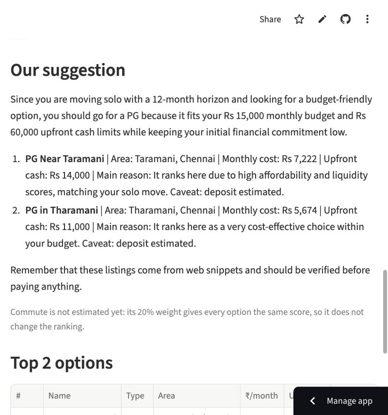

# Home Finder

**Live demo: https://realestateagent-fpkc5mkc5tgmpsmd3w6ins.streamlit.app/** (a saved Chennai search; press *Find my home*)



Someone moving to a new Indian city can't tell which PG or flat is best *for them*. Listing sites show what exists, not what the user can afford, whether they can fund the deposit, or what suits their life. Home Finder takes the user's budget, cash, stay length and lifestyle, reads listings found on the web, and ranks the top 7 on **real monthly cost and upfront cash**, with every number traceable.

## The idea: the LLM interprets, code decides

```
form → web search → LLM #1 reads pages into listings → code: merge duplicates, cost, score, filter, rank → LLM #2 explains
```

- **LLM #1** turns messy page text into structured listings and review evidence. It never sees the user's budget or profile.
- **Code** does all the arithmetic and the ranking: effective monthly cost (deposit refund, lock-in and stay length included), hard cutoffs for budget, cash and must-haves, a six-part score from a rulebook (`rulebook.toml`, documented in `rulebook.md`). The same data and profile always give the same ranking.
- **LLM #2** only explains the ranked result in plain English, using the facts it is given.
- Honest about uncertainty: unknown values score neutral, lower a confidence tag that is shown, and defaults are labelled as assumptions. Every option shows its sources. If fewer than 7 pass, the closest misses are listed with the one limit each failed.

Architecture diagram and the node table: [docs/architecture.md](docs/architecture.md).

## How it was checked

| Check | Result |
|---|---|
| Offline tests (cost maths, scoring, filters, dedup, ranking regression, property tests, explanation checks, demo limits) | 213 pass, no network |
| Extraction on 42 golden pages, real model (`gemini-3.5-flash-lite`, 7 calls, batches of 6) | listing recall 86%, precision 100%, invented rents 0%, `source_type` 88%, schema-valid 86% |
| Ranking on 5 golden user profiles | frozen snapshot; repeat runs identical; a higher budget never removes an option |
| Explanation text | code checks that every number and name came from the facts, order matches, flags and a verify line are present |

Details: [docs/evals/extraction_b6.md](docs/evals/extraction_b6.md), [evals/golden/README.md](evals/golden/README.md).

## Known limits

- **The golden answer keys are Claude's judgment**, not ground truth; only 16 of 42 were confirmed by a person. The ranking snapshot is a regression guard, not proof the ranking is right.
- **The extraction numbers rest on one run** with the Gemini budget limited to 7 calls. The 86% schema-valid figure is probably one failed batch of six pages (not confirmed); the app would split and retry such a batch. Pass thresholds are proposals, not accepted.
- **Not tested: prompt injection.** Scraped text is treated as data by design, but no adversarial test has been run. Failure handling and cost caps are not tested end to end either.
- **Not checked: advice quality.** Nothing checks that the PG-vs-flat advice fits the user's answers (no LLM judge, because of the call limit).
- **Commute is not estimated**, so its 20% weight is the same for every option and cannot change the ranking (the UI says so).
- **The public demo is thin**: it serves a saved Chennai search of which only 5 pages pass the filter, so the default example gets 2 options. Live search for other cities works with your own Tavily and Gemini keys.
- The demo's daily run limit is a local counter and resets when the hosted app restarts. The licences of the saved page text and the cost-of-living CSV in this repository have not been verified.

## What I would do next

Commute from a maps API; a verifier that flags weak points and lowers confidence; scraper tools with an allowed-domain list; prompt-injection tests and failure-handling tests; an LLM judge for the explanation; locality-level costs and per-city rulebook values; a model tier (cheaper for extraction, stronger for the explanation). The full list is in [specs/roadmap.md](specs/roadmap.md).

## Run it yourself

```bash
uv venv --python 3.13 .venv && uv pip install -r requirements.txt && uv pip install -e . --no-deps
cp .env.example .env     # add GEMINI_API_KEY; set DEMO_MODE=1 to use the saved Chennai data
.venv/bin/streamlit run src/homefinder/ui/app.py
.venv/bin/pytest         # offline tests
```

More: [docs/README.md](docs/README.md) (layout, setup, deploy), [specs/](specs/) (mission, tech stack, roadmap), [decision/decision.md](decision/decision.md) (every design decision with its reasoning). Licence: MIT.
