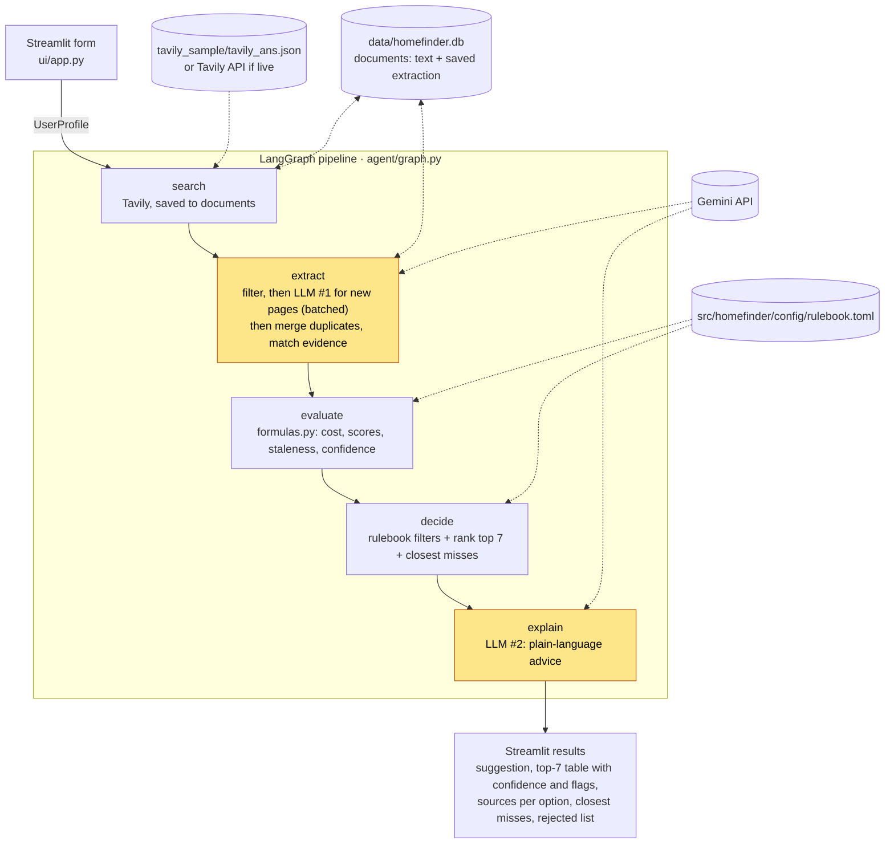

# Architecture

_Last updated: 2026-11-16. Next steps (evaluation and safety, then shipping) are in `specs/roadmap.md`; the multi-agent design is optional work after shipping. Keep this file in sync with the code whenever structure or flow changes. The long-form walkthrough is `docs/workflow_and_design.md`._

## Flow



Yellow nodes are the only two LLM calls.

State passed between nodes (`agent/state.py`): `profile → search_results → listings (+ evidence, extraction_stats) → candidates → decision → suggestion (+ run_metrics)`.

## Nodes

| Node | Code | Does | LLM? |
|---|---|---|---|
| search (demo) | `services/demo.py::demo_graph` | `DEMO_MODE=1`: the same graph, but search reads `tavily_sample/tavily_live_chennai.json`, saved answers from `data/demo_extractions.json` are loaded into an in-memory store under their own prompt version and model, the extractors raise if called, and listing age counts from the capture day. `DailyLimiter` caps runs per UTC day (SQLite) and the UI caps runs per session | No |
| search | `services/search.py` | Default: reads saved Tavily output from `tavily_sample/tavily_ans.json`. `SEARCH_SOURCE=live`: 3 Tavily queries (PG, flat, PG reviews), dedupe by URL, truncate to 1200 chars. Every result is saved to the `documents` table (`graph.py::n_search`) | No |
| extract | `agent/extraction.py::extract_pages` | Per page: optional pre-filter (`core/prefilter.py`) → reuse the saved extraction → otherwise extract with `services/llm.py::extract_document` (one page per call, JSON validated as `ListingBatch`, one retry) or `extract_documents` (several pages per call) and save per page. The prompt knows nothing about the user or city. Unknown fields stay `None`, commute is always unknown. The answer for a page is its listings, its page type (`source_type`) and evidence items. Code then attaches provenance and the missing-fields list, merges duplicates (`core/dedup.py`) and matches evidence to properties (`core/evidence.py`) | **Yes (1)**, only for new or stale pages that pass the filter |
| evaluate | `core/rules.py::evaluate` | Fills missing costs from city data (else `[defaults]`), splits flat costs across sharers, runs `cost()`, computes 6 scores, weighted final score minus the staleness penalty, sets the confidence tag and flags, records each failed hard cutoff with its size | No |
| decide | `core/rules.py::decide` | Drops rejected, sorts by score, keeps `top_n` (7), picks PG vs flat by mean of each kind's top `kind_window` (3); when fewer than `top_n` pass, adds the closest misses | No |
| explain | `services/llm.py::write_suggestion` | Plain-language recommendation grounded only in the ranked facts; skipped if nothing survives | **Yes (2)** |

## Extraction cost controls (Phase 6)

Settings in `rulebook.toml` `[search]` and `[extraction]`; the shipped defaults are filter on and 5 pages per call (`prefilter = false`, `batch_size = 1` give the Phase 5 behaviour). Measurements are in `docs/benchmarks/phase6_extraction.md`; `phase6_results.md` was regenerated after Phase 7 lengthened the prompt.

- **Pre-filter** (`prefilter = true`): a page is skipped, with no LLM call, when its domain is in `blocked_domains`, its text is shorter than `min_chars`, or it contains no rupee-style amount (₹ / Rs / INR / "Lac" / "15k" / "9500/month" / "rent … 9500"; dollar amounts, years and pin codes don't count). Skipped pages stay saved as `extraction_status = skipped` with the reason in `failure`; the filter is re-checked every run and never overwrites a saved extraction.
- **Batching** (`batch_size` > 1): up to `batch_size` pages and `batch_max_chars` characters go in one call (`=== DOC n ===` headers, answer keyed by `doc_id`). The source URL is set by code from the `doc_id`. Safeguards: a page missing from the answer is re-sent in a smaller batch; a rent that is not in a page's own text but is in another page of the batch triggers a one-page re-extract; any invalid batch is split in half down to single pages, which use the unchanged one-page extractor. Results are saved per URL, so the cache, version hash and failure markers work as before, and changing `batch_size` does not invalidate saved extractions. Network/API errors propagate, as for single pages.
- **Metrics:** `services/metrics.py::METER` counts LLM calls and tokens from each Gemini response; the graph adds seconds per step and page/skip/reuse counts into `run_metrics`, shown under the results and appended to `data/run_log.jsonl` (counts and timings only, nothing about the user; git-ignored).

## Saved documents

`services/documents.py::DocumentRepo` keeps one SQLite row per source URL in `data/homefinder.db` (path via `DB_PATH`; git-ignored): `raw_text`, `content_hash`, provenance (`source_url`, `agent_source` = `tavily:sample` or `tavily:live`, `first_seen_at`, `retrieved_at`) and the saved extraction (`extraction_json`, `extraction_status` = pending / ok / failed / skipped, `prompt_version`, `model_id`, `failure`).

- Re-saving a search result with the same text only refreshes `retrieved_at`; changed text resets the extraction to pending.
- A document is extracted only when it is pending or its saved `prompt_version` (a hash of the extraction prompt + listing schema, so editing either bumps it) or `model_id` differs from the current ones. A second run therefore makes zero extraction calls.
- Invalid model output is saved as `failed` and not retried until the version or model changes. Network/API errors are not saved (transient).
- Commute is not extracted (it depends on the user), so it stays unknown and scores a neutral 5 until the maps item on the roadmap.

## Rulebook completeness (Phase 7)

All of this is plain code after extraction; thresholds are in `rulebook.toml`.

- **Provenance:** `extract_pages` copies each page's `source_url`, `source_type`, `agent_source`, `first_seen_at` and `retrieved_at` from its `documents` row onto its listings (`Listing.provenance`). These fields, with `observations`, `missing_fields`, `property_id` and matched `evidence`, are hidden from the LLM's schema (`SkipJsonSchema`), so the model cannot supply them and they are not part of the prompt version.
- **Deduplication** (`core/dedup.py`): same locality and type, non-conflicting BHK/sharing, rent within 5%, and a matching phone, building name or geo-point. The merged listing keeps every source in `observations`, takes values from the most reliable source (`[source_values]`) and gets a `property_id` computed per run (not stored).
- **Estimated deposit:** a missing deposit uses the median months-of-rent of the run's listings of that type (at least `deposit_median_min`), else the rulebook default. `Candidate.deposit_basis` says which.
- **Confidence tag** (`formulas.confidence_tag`): high / medium / low from missing key fields and the extractor's `extraction_confidence`. Never scored.
- **Staleness** (`formulas.staleness`): age from the earliest `first_seen_at` across `observations`; 0.3 / 0.5 / 0.7 off the final score from 15 / 30 / 45 days, "re-verify" from 45. `build_graph(today=...)` injects the date for tests.
- **Closest misses** (`rules.closest_misses`): rejected listings that failed exactly one hard cutoff, smallest overshoot first, filling up to `top_n`. A PG rejected for a family (`unsuitable`) is not a near miss.
- **Evidence** (`core/evidence.py`): items (subject, aspect, polarity, severity) are matched to properties by name. Only items from `forum` and `review` pages move Reputation, one value per distinct source; ads and builder pages count only as source reliability in the merge. The aspect map decides which criterion a caveat is listed under.

## City

The city is a required `UserProfile.city` (editable in the UI, default "Chennai" as a dev default). It feeds the search queries and the explain prompt (`prompts.explain_system(city)`); the extraction prompt is city-independent. The saved Tavily sample covers only Chennai (`config.SAMPLE_CITY`), so in sample mode any other city raises `SampleModeError` in `search.py` and the UI shows the same message before running anything.

## City cost data

`services/city_costs.py` loads `data/livingcost_india_all_inr.csv` (221 Indian cities) and looks the user's city up by name ("Chennai, Tamil Nadu" and leading spaces are cleaned). `evaluate` uses it to estimate food and utilities in place of the flat `[defaults]` guesses, and to label rent against the city benchmark (not scored). A city that is missing, or whose row is impossible (rent above 75% of cost), falls back to the labelled defaults. Rows with a repeated (cost, rent) pair are flagged suspect. The UI shows which basis was used.

## Rules

- **Hard cutoffs (reject):** effective monthly > budget; upfront > cash; known commute > tolerance; known clash with a must-have.
- **Closest misses:** failed exactly one hard cutoff; shown only when fewer than `top_n` pass.
- **Scores (0–10):** affordability, commute, liquidity, lifestyle, reputation, flexibility. Weights and formula thresholds (`[scoring]`, `[lifestyle]`) from `src/homefinder/config/rulebook.toml`, validated on load (weights sum to 100); liquidity weight is boosted when cash < 3× budget, then renormalised.
- **Unknown data:** lifestyle unknown = 0.5, commute unknown = 5, reputation with no evidence = 5 (all set in the rulebook); unknowns never trigger a must-have rejection, and each one lowers the confidence tag.

## Layout

```
decision/decision.md      design decision log
specs/                    constitution: mission, tech-stack, roadmap (planned phases)
docs/architecture.md      this file
docs/workflow_and_design.md  full workflow and design reference
src/homefinder/
  config/                 config.py (paths, env, rulebook loader), rulebook.toml (weights, money, liquidity, [scoring], [lifestyle], [decision], [defaults], [confidence], [dedup], [staleness], [source_values], [evidence]), rulebook.md
  schemas.py              UserProfile, Listing, Provenance, EvidenceItem, ListingBatch
  core/                   formulas.py (cost, scores, lifestyle, confidence, staleness), rules.py (evaluate, decide, closest misses), dedup.py, evidence.py, prefilter.py (page pre-filter) (deterministic)
  agent/                  graph.py, extraction.py (filter, cache, batching), state.py, prompts.py
  services/               search.py (Tavily), llm.py (Gemini via langchain-google-genai), documents.py (SQLite store), city_costs.py, metrics.py (run meter)
  evals/                  golden.py (loader for the golden set), extraction_eval.py (scoring against the keys), ranking_eval.py (pipeline run and ranking snapshot, no LLM), explanation_eval.py (checks an explanation against its facts, no LLM) (Phase 8)
  ui/app.py               Streamlit page
evals/golden/             golden pages, profiles and answer keys (see its README)
tavily_sample/            saved Tavily response used as the default search source
tests/                    offline tests (stubbed search/LLM); test_golden.py checks the golden set
```

## External dependencies

Tavily API (`TAVILY_API_KEY`, only when `SEARCH_SOURCE=live`; otherwise `tavily_sample/tavily_ans.json`, Chennai only), Gemini API (`GEMINI_API_KEY`, model via `MODEL`, default `gemini-3.5-flash-lite`).

## Known limitations

- Commute is not estimated (it scores a neutral 5 and never rejects) until a maps step.
- The Phase 7 extraction fields (`source_type`, evidence items, `extraction_confidence`, phone, building) have not been checked against the real Gemini model.
- Review and forum pages with no rupee amount are skipped by the prefilter unless their domain is in `[extraction] evidence_domains` (empty by default), so evidence mostly comes from pages that also hold a listing.
- Geo-points are matched in dedup only when a page states coordinates; nothing geocodes addresses.
- Listing age counts from this app's first sighting, so a fresh database applies no staleness penalty.
- `[defaults]` are assumptions, not market data.
- Listings come from web snippets and are unverified.
