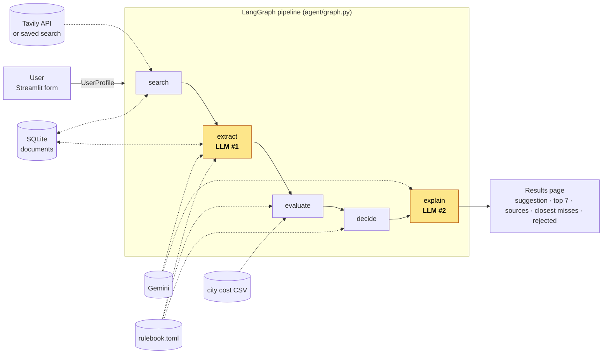
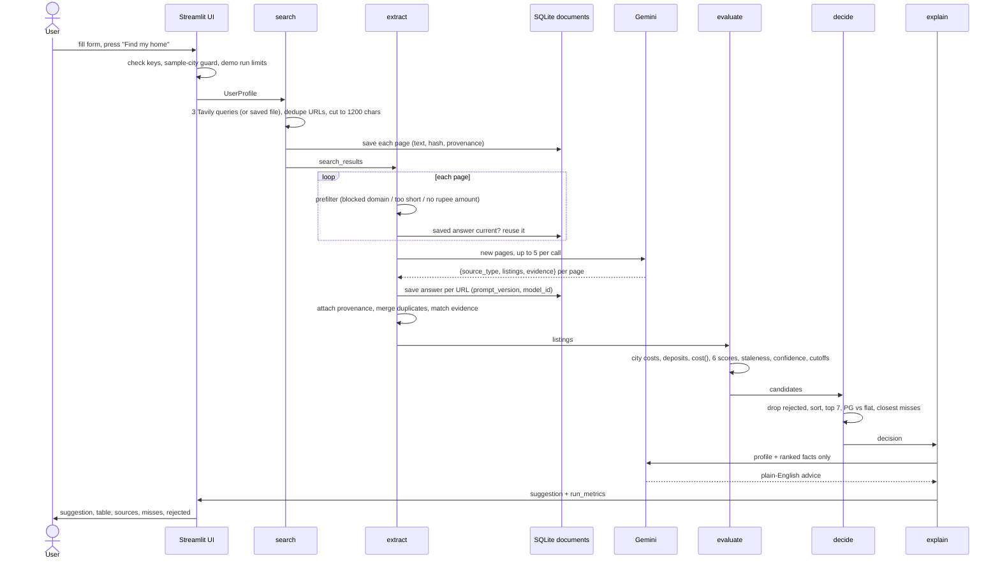
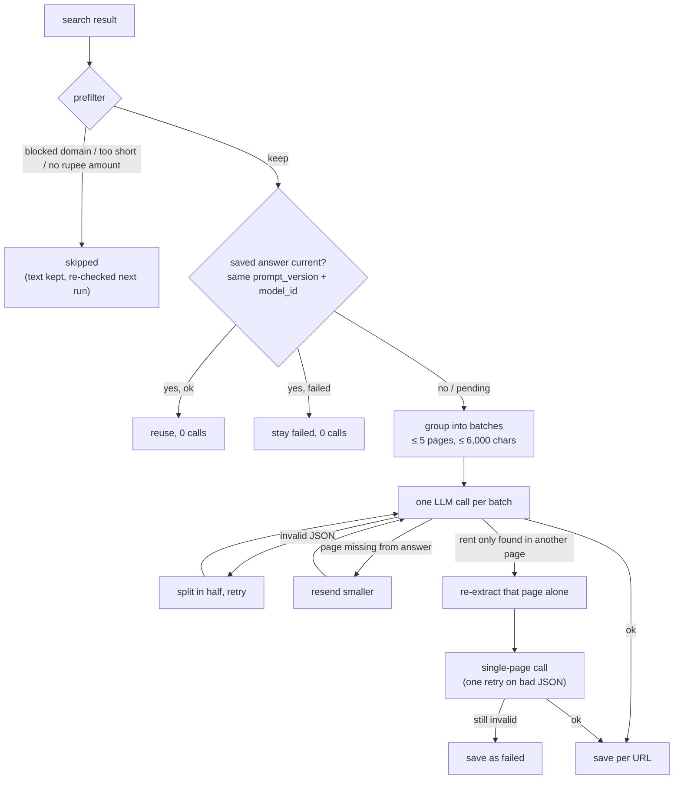
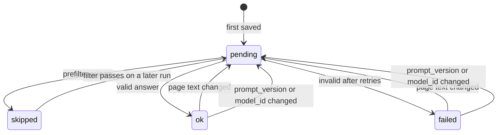

# Home Finder: Workflow and Design

_Written 21-11-2026 from the code on `main`. This is the long-form reference: what happens on a run, why it is built that way, and how the project itself is developed. Shorter companions: [README.md](../README.md) (two-minute overview), [architecture.md](architecture.md) (diagram and node table), [rulebook.md](../src/homefinder/config/rulebook.md) (every rulebook value), [decision.md](../decision/decision.md) (why each choice was made)._

---

## Contents

1. [The problem and the mission](#1-the-problem-and-the-mission)
2. [Design principles](#2-design-principles)
3. [System overview](#3-system-overview)
4. [End-to-end workflow of one run](#4-end-to-end-workflow-of-one-run)
5. [Data model](#5-data-model)
6. [Extraction design (LLM #1)](#6-extraction-design-llm-1)
7. [Saved documents and caching](#7-saved-documents-and-caching)
8. [Merging duplicates and evidence](#8-merging-duplicates-and-evidence)
9. [Cost engine](#9-cost-engine)
10. [Scoring](#10-scoring)
11. [Hard cutoffs, ranking and closest misses](#11-hard-cutoffs-ranking-and-closest-misses)
12. [Confidence, staleness and flags](#12-confidence-staleness-and-flags)
13. [Explanation (LLM #2)](#13-explanation-llm-2)
14. [User interface](#14-user-interface)
15. [Run modes: sample, live and demo](#15-run-modes-sample-live-and-demo)
16. [Configuration](#16-configuration)
17. [Evaluation and testing](#17-evaluation-and-testing)
18. [Deployment](#18-deployment)
19. [Development workflow](#19-development-workflow)
20. [Repository layout](#20-repository-layout)
21. [Known limits and next steps](#21-known-limits-and-next-steps)

---

## 1. The problem and the mission

Someone moving to a new Indian city has to choose a PG (paying-guest bed) or a flat without knowing the market. Listing sites show what exists. They do not show what the user can really afford once the deposit, brokerage, lock-in and stay length are counted, or whether the user has the cash to move in at all.

**Mission** ([specs/mission.md](../specs/mission.md)): recommend the top 7 PGs or flats in the city the user names, chosen for the user's financial wellbeing and lifestyle; explain every recommendation honestly, and trace every number to a deterministic rule.

Success for v1:

1. The user answers money, occupancy and lifestyle questions and gets up to 7 ranked options, or fewer plus the closest misses with the limit each one failed.
2. Every option shows its effective monthly cost, upfront cash, score breakdown, caveats and confidence.
3. The same stored data and profile always give the same ranking.
4. PG-versus-flat advice comes from this user's numbers, not a generic rule.

---

## 2. Design principles

| # | Principle | How the code enforces it |
|---|---|---|
| 1 | **The LLM interprets; code decides.** | Only two LLM calls exist, both in `services/llm.py`. Every number that ranks a place comes from `core/formulas.py` and `core/rules.py`. |
| 2 | **Financial wellbeing first.** | Budget and upfront cash are hard cutoffs. A tight-cash user gets a higher liquidity weight. |
| 3 | **Config, not code.** | Weights, thresholds and assumptions live in `rulebook.toml`; the loader refuses weights that do not sum to 100. |
| 4 | **Honest about uncertainty.** | Unknown values score neutral, never reject, lower a visible confidence tag; estimated values are labelled. |
| 5 | **Provenance on everything.** | Each listing carries its source URL, page type, agent, first-seen and last-fetched times, set by code, hidden from the LLM schema. |
| 6 | **Scraped text is data, not instructions.** | Extraction prompt is fixed and user-independent; the model never sees the user's profile. (Not yet adversarially tested.) |
| 7 | **No city is hard-coded.** | City comes from `UserProfile.city`; Chennai appears only as dev data and the sample guard. |
| 8 | **Ship it / small steps.** | Phased roadmap; each step lands with tests and a decision-log entry. |

---

## 3. System overview



The graph is deliberately **linear**: five nodes, no branches, no loops. Each node is a plain function injected through `build_graph(...)`, so tests replace search and both LLM calls with stubs and run fully offline.

**State** passed between nodes (`agent/state.py`):

```
profile → search_results → listings (+ evidence, extraction_stats) → candidates → decision → suggestion (+ run_metrics)
```

**Tech stack**: Python ≥ 3.11, LangGraph, Gemini (`langchain-google-genai`, default `gemini-3.5-flash-lite`), pydantic v2, Tavily, SQLite (stdlib), Streamlit, pytest, `uv`. Details: [specs/tech-stack.md](../specs/tech-stack.md).

---

## 4. End-to-end workflow of one run



### Step by step

| Step | Code | Input → output | LLM |
|---|---|---|---|
| **0. Intake** | `ui/app.py` | Form → `UserProfile` (validated by pydantic). Stops early on missing keys, a non-Chennai city in sample mode, or a used-up demo limit. | No |
| **1. Search** | `services/search.py`, `graph.py::n_search` | Work location + city → list of `{title, url, content}`. Live mode runs 3 queries (PG, flat, PG reviews), 8 results each, dedupes by URL, keeps 1,200 chars. Every result is saved to `documents`. Only the location and city are sent to search, never the budget. | No |
| **2. Extract** | `agent/extraction.py::extract_pages` | Pages → listings + evidence. Prefilter, reuse saved answers, extract the rest in batches, then provenance, dedup, evidence matching. | **Yes (#1)** |
| **3. Evaluate** | `core/rules.py::evaluate` | Each listing → `Candidate` with cost, six scores, final score, confidence, flags and any rejections. | No |
| **4. Decide** | `core/rules.py::decide` | Candidates → `Decision` (ranked top 7, rejected, recommended kind, closest misses). | No |
| **5. Explain** | `services/llm.py::write_suggestion` | Profile + ranked facts → prose. Skipped if nothing passes. Writes run metrics and a run-log line. | **Yes (#2)** |

---

## 5. Data model

All models are in `src/homefinder/schemas.py`.

### `UserProfile` (what the user tells us)

| Field | Values | Used for |
|---|---|---|
| `city`, `work_location` | text | search queries, explain prompt, city cost lookup |
| `budget` | Rs/month > 0 | hard cutoff, affordability score |
| `upfront_cash` | Rs > 0 | hard cutoff, liquidity score, tight-cash weight boost |
| `horizon_months` | 6 / 12 / 24 / not sure (→ 12) | cost spread, flexibility |
| `mover`, `group_size` | solo / friends / family | flat cost splitting (`sharers`), family-excludes-PG rule, meal cost × family size |
| `commute_tolerance` | 20 / 40 / 60 / 90 | cutoff and score once commute is known (unused today) |
| `food`, `privacy`, `furnishing`, `noise`, `gender_restricted` | choices | lifestyle match |
| `must_have` | per lifestyle key | turns a known clash into a rejection |

Derived: `horizon` (default 12), `sharers` (group size for friends, else 1), `bhk`.

### `Listing` (what LLM #1 extracts, then code enriches)

- **From the LLM**: `name`, `kind` (pg/flat), `area`, `rent` (required, > 0; per bed for PG, whole unit for flat), `maintenance`, `extras`, `deposit`, `brokerage`, `lock_in_months`, `notice_months`, `furnishing`, `private_room`, `meals_included`, `kitchen_access`, `vibe`, `gender_restricted`, identity fields (`building_name`, `phone`, `bhk`, `sharing`, `lat`, `lng`), `extraction_confidence`. Unknown stays `None`.
- **Forced by code**: `url` (from our own document, not the model), `commute_minutes = None`.
- **Set by code, hidden from the LLM schema** (`SkipJsonSchema`): `provenance`, `observations` (every source that showed the property), `missing_fields`, `property_id`, matched `evidence`. Hiding them means the model cannot supply provenance and they do not affect the prompt-version hash.

### Others

- `Provenance`: `source_url`, `source_type` (ad / builder / forum / review), `agent_source`, `first_seen_at`, `retrieved_at`.
- `EvidenceItem`: `subject`, `aspect` (11 aspects), `polarity`, `severity`. "Good rooms but rude caretakers" is two items.
- `ListingBatch`: the saved answer for one page: `{source_type, listings, evidence}`. `BatchAnswer` wraps several pages keyed by `doc_id`.
- `CityCosts`: one CSV row with `data_quality` (ok / suspect) and `usable`.
- In `core/rules.py`: `Candidate` (listing + costs + scores + confidence + flags + `Rejection`s) and `Decision`.

---

## 6. Extraction design (LLM #1)

### Prompt

`agent/prompts.py::EXTRACT_SYSTEM` is **independent of the user and the city**, which is what makes its output reusable across users. Key rules:

- Include a listing only when the text gives a concrete monthly rent in rupees; never invent numbers.
- Price ranges or "from" prices → one listing per option at the lowest stated price, confidence "medium" (added after the first real Gemini run, decision #48).
- Page-wide terms ("deposit is one month's rent", "food not included") apply to every listing on the page.
- Classify the page (`source_type`) and pull evidence items about named properties, one per aspect.
- `commute_minutes` is always null.

The reply must be JSON matching the `ListingBatch` schema, which is appended to the prompt.

### Cost controls (Phase 6)



- **Prefilter** (`core/prefilter.py`): skips a page when its domain is blocked (social media, `sec.gov`), its text is under 80 characters, or it has **no rupee-style amount** (₹ / Rs / INR / lakh / "15k" / "9500/month" / "rent … 9500"). Bare 4-digit numbers do not count, because years, PIN codes and square feet would keep junk pages. On the live Chennai capture this cut 22 pages to 5 with no expected listing lost. Wrongly skipping loses listings; wrongly keeping costs a little prompt space, so the filter only drops obvious junk.
- **Batching**: up to `batch_size` (5) pages and `batch_max_chars` (6,000) per call, each page headed `=== DOC n ===`. Code, not the model, maps each answer back to its URL. The safeguards make the worst case equal to one call per page.
- **Mixed-up check**: if a listing's rent is not in its own page's text but is in another page of the batch, the model confused pages; that page is re-extracted alone.
- **Errors**: invalid model output is saved as `failed` and not retried until the prompt or model changes. Network/API errors are not saved (they are transient) and propagate.

### Post-processing (plain code)

1. Attach `Provenance` from the `documents` row and the `missing_fields` list.
2. Merge duplicates (`core/dedup.py`, §8).
3. Match evidence to properties by name (`core/evidence.py`, §8).
4. Record `extraction_stats`: reused, extracted, failed, skipped, calls, duplicates merged.

---

## 7. Saved documents and caching

`services/documents.py::DocumentRepo` keeps **one SQLite row per source URL** in `data/homefinder.db` (git-ignored; path from `DB_PATH`). All SQL lives in this one module.

| Column group | Columns |
|---|---|
| Identity / text | `source_url` (unique), `title`, `raw_text`, `content_hash` |
| Provenance | `agent_source` (`tavily:sample`, `tavily:live`, `demo`), `first_seen_at`, `retrieved_at` |
| Saved extraction | `extraction_json`, `extraction_status` (pending / ok / failed / skipped), `failure`, `prompt_version`, `model_id`, `extracted_at` |

**Lifecycle**



- Re-saving the same text only refreshes `retrieved_at`; changed text resets the extraction.
- `prompt_version` is a 10-character SHA-256 of the extraction prompt plus the `ListingBatch` JSON schema. Editing either re-extracts automatically; nobody has to remember to bump a version. The batch wrapper text is not part of the hash, so changing the batch size does not invalidate saved answers.
- Consequence: **a second run over the same pages makes zero extraction calls.**

---

## 8. Merging duplicates and evidence

### Deduplication (`core/dedup.py`)

The same flat is often advertised on several portals. Two listings are one property when:

1. **Block**: same `kind` and same normalised locality; BHK and sharing do not conflict (unknown fits anything);
2. **Price**: rents within 5% of the larger;
3. **Identity**: a phone number (last 10 digits), a normalised building name (or listing name), or geo-points within 100 m agree.

The merged record takes its values from the most reliable source (`[source_values]`: ad 7, builder 5), then the earliest sighting, and fills blanks from the others. `observations` keeps every source, so the UI lists them all and staleness counts from the earliest. `property_id` is a hash computed each run, not stored.

### Evidence (`core/evidence.py`)

- Items are matched to properties by name (exact, or a whole-word partial match of at least 6 characters, so "PG" does not match every PG).
- **Only forum and review pages move Reputation.** An advertiser praising itself does not count.
- Each distinct independent source contributes one value: the mean of its items, each worth +7 (positive) or −7 (complaint) times severity (low 0.5, medium 0.75, high 1.0).
- The aspect map (`[evidence.aspect_criteria]`) decides which criterion a caveat is shown under in the UI; in v1 only Reputation's score moves.

---

## 9. Cost engine

`core/formulas.py::cost` turns a listing into what the user will really pay. All amounts are **per person**: a flat's rent, deposit, brokerage and setup are divided by `sharers` for friends; a family is one paying unit; PG prices are already per bed.

### Inputs and where missing values come from

| Symbol | Meaning | If the listing does not say |
|---|---|---|
| R | rent | required |
| M | maintenance | 0 |
| O | extras (power, wifi, water; plus meals if needed and not included) | flats: city estimate (else ₹2,500); PG: 0. Meals: city estimate (else ₹4,500) × family size |
| D | deposit | median months-of-rent of this run's listings of the same kind (if ≥ 3 state one), else 2 months (PG) / 6 months (flat); labelled "estimated" |
| B | brokerage | flat: 1 month's rent; PG: 0 |
| S | setup | flat by furnishing: 0 / ₹15,000 / ₹40,000; PG: 0 |
| L | lock-in | PG 1, flat 6 months |
| t | stay length | user's horizon (default 12) |
| r_m | monthly opportunity cost of cash | 0.0075 (9% a year) |
| δ | expected deposit deduction | 10% |

City estimates come from `data/livingcost_india_all_inr.csv` (221 cities): non-rent cost × 50% housing-linked share, split 70% food / 30% utilities and wifi. For Chennai that is about ₹9,564 food and ₹4,099 utilities. A city that is missing, or whose row is impossible (rent above 75% of total cost), falls back to the labelled defaults.

### Formulas

```
t_paid          = max(t, L)                         # a lock-in longer than the stay is still paid
TCO             = B + S + (R + M + O)·t_paid + D·r_m·t_paid + δ·D
effective_month = TCO / t
upfront         = D + B + S                         # advance rent is 0 in v1
```

The deposit enters as its **opportunity cost and expected loss**, not its face value, because it comes back. A ₹60,000 refundable deposit over 12 months costs about ₹5,400 + ₹6,000 = ₹11,400 in total, not ₹60,000. It still counts in full against the user's cash (`upfront`).

---

## 10. Scoring

Six sub-scores on 0–10, from `core/formulas.py`, with shapes set in `[scoring]`:

| Criterion | Weight | Formula | Unknown |
|---|---|---|---|
| Affordability | 30 | r = effective / budget; 10 at r ≤ 0.6, 0 at r ≥ 1.0, linear between | — |
| Commute | 20 | 10 at ≤ 25% of tolerance, 0 at tolerance | **5 (always today)** |
| Liquidity | 15 | h = 1 − upfront / cash; 10 when h ≥ 0.5 | — |
| Lifestyle | 15 | 10 × mean of food, privacy, furnishing, noise, gender matches (match 1, clash 0, unknown 0.5; preferences the user does not hold are ignored) | 0.5 per field |
| Reputation | 10 | 5 + Σ(independent source values) / 2 | 5 |
| Flexibility | 10 | 0.6 × 10 × (1 − L/t) + 0.4 × 10 × (1 − notice/3), parts clamped to 0–1 | defaults for L and notice |

**Tight cash**: when cash < 3 × budget, the liquidity weight is multiplied by 1.5 and all weights are renormalised to 100.

**Final score** = Σ(weight × sub-score) / 100 − staleness penalty, clamped to 0–10.

### Worked example (illustrative)

Solo user, budget ₹15,000, cash ₹60,000, 12 months. A PG at ₹9,000 with an ₹18,000 deposit, meals not needed, no lock-in or notice stated.

```
TCO        = 9,000·12 + 18,000·0.0075·12 + 0.1·18,000 = 108,000 + 1,620 + 1,800 = 111,420
effective  = 111,420 / 12 ≈ 9,285          upfront = 18,000
afford     = 10·(1 − 0.619)/0.4 ≈ 9.52      liquidity: h = 0.70 → 10
flex       = 0.6·10·(11/12) + 0.4·10·(2/3) ≈ 8.17
cash 60,000 ≥ 3·15,000, so no weight boost
with commute 5, lifestyle 7.5, reputation 5:
final      = (30·9.52 + 20·5 + 15·10 + 15·7.5 + 10·5 + 10·8.17)/100 ≈ 7.80
```

---

## 11. Hard cutoffs, ranking and closest misses

### Hard cutoffs (any one rejects)

| Kind | Rule |
|---|---|
| `budget` | effective monthly > budget |
| `upfront` | upfront cash > available cash |
| `commute` | **known** commute > tolerance (never fires today) |
| `unsuitable` | a PG when the mover is a family (`family_excludes_pg = true`) |
| `must_have` | a **known** clash on a must-have preference |

Unknown values never reject. Each rejection records its size (`gap`, e.g. 0.06 = 6% over).

### Decide

1. Drop rejected candidates; sort survivors by final score.
2. Keep the top `top_n` (7).
3. **PG vs flat**: whichever kind has the higher mean score over its best `kind_window` (3) survivors. The agent, not the user, picks the housing type.
4. **Closest misses**: if fewer than 7 pass, fill the gap with rejected listings that failed **exactly one** cutoff, smallest overshoot first, then best score; must-have clashes last; unsuitable PGs never.

---

## 12. Confidence, staleness and flags

- **Confidence tag** (high / medium / low): weak points = missing key fields + 0/1/3 for the extractor's high/medium/low confidence (1 if unknown). ≤ 3 → high, ≤ 6 → medium, else low. **Shown, never scored**, so the model's self-assessment cannot rank anything.
- **Staleness**: age = days since the earliest `first_seen_at` across the property's sources. Penalties 0.3 / 0.5 / 0.7 at 15 / 30 / 45 days; 45+ also flags "re-verify". The spec's penalties were 3 / 5 / 7; they were cut to a tenth because top scores sit around 6–8 (decision #45).
- **Flags** shown in the table and passed to the explanation: "deposit estimated", "re-verify", "first seen N days ago".
- **Rent vs city benchmark**: per-person rent as % above/below the city's one-person rent. Informational only; not shown for families.

---

## 13. Explanation (LLM #2)

`services/llm.py::write_suggestion` sends `explanation_facts(profile, decision)`: the profile, the recommended kind and, for each ranked option, name, type, area, rounded monthly cost and upfront, score, sub-scores, unknowns, confidence and flags. Nothing else.

The prompt (`EXPLAIN_SYSTEM`) asks for: one paragraph on PG vs flat tied to the user's answers; a numbered list in the given order with cost, upfront, the main reason and one caveat (flags preferred); a final line to verify listings before paying. It must not mention commute times.

`evals/explanation_eval.py::check` verifies an explanation in code: every number and property name appears in the facts, order matches, flags are mentioned, no commute minutes, and the verify line is last. If nothing is ranked, no call is made.

---

## 14. User interface

`src/homefinder/ui/app.py` (Streamlit); `streamlit_app.py` at the root is the hosted entry point.

1. **Header**: what the app does, plus a demo notice with the data date in demo mode.
2. **Form**: city, work location, budget, cash, stay length, who is moving and group size, commute tolerance (labelled unused), move-in date, lifestyle preferences each with a must-have box.
3. **Guards**: missing keys, sample-city guard, demo per-session (3) and per-day (50) limits.
4. **Results**:
   - run caption (pages, skipped, reused, calls, tokens, seconds) and duplicates merged;
   - **Our suggestion**: the LLM text plus a note that commute is not estimated;
   - **Top N options** table: cost, upfront, score, confidence, flags, vs-city-rent;
   - an expander per option: every source, confidence reasons, caveats grouped by criterion, score breakdown;
   - cost-basis caption (city data, suspect city data, or defaults);
   - **Closest misses** with the failed limit and by how much;
   - **Rejected** list with reasons.

---

## 15. Run modes: sample, live and demo

| Mode | Set by | Search | Extraction calls | Use |
|---|---|---|---|---|
| **sample** (default) | `SEARCH_SOURCE=sample` | `tavily_sample/tavily_ans.json` (6 Chennai pages) | new pages only, then cached | development; other cities are refused with a clear message |
| **live** | `SEARCH_SOURCE=live` + `TAVILY_API_KEY` | 3 Tavily queries for any city | new pages only, then cached | real use |
| **demo** | `DEMO_MODE=1` | `tavily_sample/tavily_live_chennai.json` (22 pages) | **none**: saved answers from `data/demo_extractions.json` are loaded into an in-memory store; the extractors raise if called | public demo: 1 Gemini call per run |

Demo mode reuses the same graph (`services/demo.py::demo_graph`), counts listing age from the capture day so the demo does not drift into "re-verify", and caps runs with `DailyLimiter` (SQLite, UTC day) plus a per-session counter. Only 5 of the 22 pages pass the prefilter, so the default example returns 2 options. Rebuild the saved answers after a prompt change with `scripts/build_demo_data.py --yes` (about 1 call).

---

## 16. Configuration

### Environment (`.env`, see `.env.example`)

| Variable | Default | Purpose |
|---|---|---|
| `GEMINI_API_KEY` | — (required) | LLM access |
| `MODEL` | `gemini-3.5-flash-lite` | model id |
| `SEARCH_SOURCE` | `sample` | `sample` or `live` |
| `TAVILY_API_KEY` | — | only for `live` |
| `DB_PATH` | `data/homefinder.db` | documents store |
| `DEMO_MODE` | off | `1` for the public demo |
| `DEMO_SESSION_RUNS` / `DEMO_DAILY_RUNS` | 3 / 50 | demo limits |

### Rulebook (`src/homefinder/config/rulebook.toml`)

| Table | Controls |
|---|---|
| `[weights]` | the six criterion weights (must sum to 100) |
| `[money]` | opportunity rate, deposit deduction, housing-linked and food shares |
| `[liquidity]` | tight-cash threshold and boost, healthy buffer |
| `[scoring]` | sub-score shapes and neutral values |
| `[lifestyle]` | match / clash / unknown values |
| `[city_costs]` | impossible-row rule |
| `[search]` | results per query, characters per result |
| `[extraction]` | prefilter, blocked and evidence domains, batch size and size cap |
| `[confidence]` | weak-point thresholds |
| `[dedup]` | rent tolerance, geo radius |
| `[staleness]` | age bands and penalties |
| `[source_values]`, `[evidence]` | source reliability, review values, severity, aspect map |
| `[decision]` | `top_n`, `kind_window`, `family_excludes_pg` |
| `[defaults]` | assumptions for missing values (labelled, not market data) |
| `[city_overrides]` | reserved, not read yet |

Every value is explained in [rulebook.md](../src/homefinder/config/rulebook.md).

---

## 17. Evaluation and testing

### Offline tests (`tests/`, 213 passing, no network or keys)

Search and both LLM calls are stubbed. Coverage: cost maths (deposit not double-counted, short stay, lock-in > stay, shared flats), weight-flip scoring, rulebook validation, city data and sample guard, documents store and caching (second run = zero calls, version bump re-extracts only stale rows), prefilter, batching and its fallbacks, dedup, evidence, staleness bands, closest misses, demo mode and limits, explanation checker, golden-set integrity, ranking regression. GitHub Actions runs them on every push (`.github/workflows/tests.yml`).

### Golden set (`evals/golden/`)

42 pages (28 real Chennai pages, 14 hand-written hard cases on `.example` domains: ranges, multi-listing pages, duplicates, contradictions, reviews, a second city, junk with rupee amounts) and 5 profiles (solo tight cash, solo comfortable, friends sharing, family, short stay elsewhere). Keys are Claude's judgment; 16 arguable pages were confirmed by the user.

### Extraction on the real model (`scripts/eval_extraction.py`)

Dry run by default; `--yes` calls Gemini; `--max-calls` (default 7) refuses anything bigger. Baseline (21-11): all 42 pages in 7 batches of 6, `gemini-3.5-flash-lite`:

| Metric | Result |
|---|---|
| Listing recall / precision | 86% / 100% |
| Invented rents | 0% |
| `source_type` accuracy | 88% |
| Schema-valid | 86% (probably one failed batch of 6; the app would split and retry it) |
| Evidence precision / recall | 71% / 100% |

### Ranking regression

`scripts/snapshot_ranking.py` writes `evals/golden/expected.json`; tests check the snapshot, repeat-run determinism, and properties (more budget, cash or tolerance never removes an option; a repeated ad changes nothing; unknowns never reject; confidence never moves a score). The snapshot guards against silent change; it is not proof the ranking is right.

### Other scripts

`scripts/benchmark_extraction.py` (offline comparison of prefilter/batch options, results in `docs/benchmarks/`), `scripts/build_demo_data.py`.

---

## 18. Deployment

- **Host**: Streamlit Community Cloud, main file `streamlit_app.py` (adds `src/` to the import path), Python ≥ 3.11.
- **Secrets**: `GEMINI_API_KEY`, `MODEL`, `DEMO_MODE = "1"` in the app's Secrets box, never in the repository.
- **Live demo**: https://realestateagent-fpkc5mkc5tgmpsmd3w6ins.streamlit.app/
- **Cost**: one Gemini call per demo run, capped at 3 per session and 50 per day (the daily counter resets when the host restarts).
- **Observability**: `run_metrics` under the results and `data/run_log.jsonl` (counts and timings only, nothing about the user).

Local run:

```bash
uv venv --python 3.13 .venv && uv pip install -r requirements.txt && uv pip install -e . --no-deps
```

```bash
cp .env.example .env
```

```bash
.venv/bin/streamlit run src/homefinder/ui/app.py
```

```bash
.venv/bin/pytest
```

---

## 19. Development workflow

### How work is organised

- **Constitution** in `specs/`: `mission.md` (why, principles, scope), `tech-stack.md` (stack and stack rules), `roadmap.md` (phases with checkboxes).
- **Decision log** `decision/decision.md`: every decision numbered in order, each with exactly three bullets (Decision, Action, Reasoning) and a date.
- **Living docs** kept in sync with code: `README.md`, `docs/architecture.md`, `rulebook.md`, `decision.md`.
- **Small steps**: one component at a time, each with tests and a decision entry.
- **Develop offline by default**: saved search plus cached extractions mean normal runs spend no credits and repeat exactly. Real-model runs are deliberate, counted and capped.

### Phases (from `specs/roadmap.md`)

| Phase | What it delivered |
|---|---|
| 1. Baseline pipeline | form, search, extraction, costs, scores, ranking, explanation, offline tests |
| 2. Deterministic core hardened | exact-arithmetic cost and scoring tests; magic numbers moved to the rulebook; weight validation |
| 3. City is an input | no hard-coded city; sample-mode guard; generic defaults |
| 4. City cost context | cost-of-living CSV, food and utilities per city, rent benchmark label |
| 5. Saved documents | SQLite store, user-independent extraction, reuse and automatic versioning |
| 6. Cut extraction calls | metrics, prefilter, batching with fallbacks; defaults prefilter on, batch 5 |
| 7. Rulebook completeness | provenance, confidence, dedup, staleness, closest misses, evidence |
| 8. Evaluation and safety | golden set, real-model extraction baseline, ranking regression, explanation checks |
| 9. Ship | clean-up, demo mode, deploy, portfolio README |

### Stack rules worth knowing before changing code

1. Only `services/llm.py` imports an LLM SDK.
2. `core/` is pure Python: no I/O, no LLM.
3. Prompts, queries and UI text never name a city.
4. No new infrastructure (Postgres, Redis, FastAPI, maps, vector DB).
5. A new dependency goes into both `pyproject.toml` and `requirements.txt`, with a decision entry.
6. Changing the extraction prompt or `Listing` schema re-extracts every saved page on the next run (and the demo data must be rebuilt).

---

## 20. Repository layout

```
README.md                      two-minute overview, demo link, results, limits
streamlit_app.py               hosted entry point
decision/decision.md           numbered decision log
specs/                         mission.md, tech-stack.md, roadmap.md
docs/
  architecture.md              diagram, nodes, rules
  workflow_and_design.md       this document
  README.md                    setup, layout, deploy, demo mode
  benchmarks/, evals/          generated results
src/homefinder/
  schemas.py                   UserProfile, Listing, Provenance, EvidenceItem, ListingBatch, CityCosts
  config/                      config.py, rulebook.toml, rulebook.md
  core/                        formulas.py, rules.py, dedup.py, evidence.py, prefilter.py   (deterministic)
  agent/                       graph.py, extraction.py, prompts.py, state.py                 (LangGraph)
  services/                    search.py, llm.py, documents.py, city_costs.py, metrics.py, demo.py
  evals/                       golden.py, extraction_eval.py, ranking_eval.py, explanation_eval.py
  ui/app.py                    Streamlit page
scripts/                       eval_extraction.py, snapshot_ranking.py, benchmark_extraction.py, build_demo_data.py
evals/golden/                  pages.json, profiles.json, expected.json, review.md, README.md
tavily_sample/                 saved searches and hand-made answer keys
data/                          city cost CSV, demo extractions (db and run log are git-ignored)
tests/                         offline tests
```

---

## 21. Known limits and next steps

**Limits**

- Commute is not estimated, so its 20% weight is identical for every option and cannot change the ranking.
- Golden keys are mostly Claude's judgment (16 of 42 confirmed by a person); the ranking snapshot is a regression guard, not proof.
- Extraction numbers rest on one 7-call run.
- Not tested: prompt injection, failure handling and cost caps end to end, and whether the PG-vs-flat advice fits the user.
- The demo is thin (5 usable pages, 2 options for the default example).
- Listing age counts from this app's first sighting, so a fresh database applies no staleness penalty.
- Most review pages are skipped by the prefilter (no rupee amount), so little evidence reaches Reputation.
- `[defaults]` are assumptions, and listings come from unverified web snippets.
- Licences of the saved page text and the cost CSV are not verified.

**Next** (full list in `specs/roadmap.md`): commute from a maps API; a verifier that flags weak points; scraper tools with an allowed-domain list; prompt-injection and failure-handling tests; an LLM judge for the explanation; locality-level costs and per-city rulebook values; a cheaper extraction model and a stronger explanation model.
